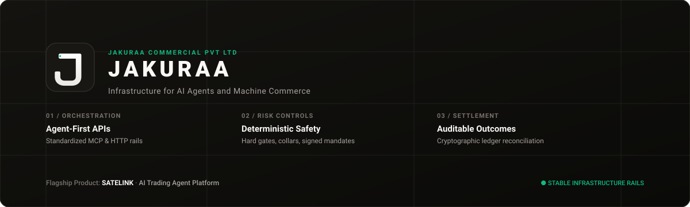

<div align="center">



# Jakuraa

**Infrastructure for AI Agents and Machine Commerce**

*Building the software systems that enable AI agents and machines to interact with services, make decisions, and execute authorized actions.*

[Corporate Website](https://jakuraa.com) • [Satelink Platform](https://satelink.network) • [Documentation](https://satelink.network) • [Contact](mailto:hello@jakuraa.com)

</div>

---

Jakuraa Commercial Pvt Ltd builds software infrastructure for autonomous AI agents and machines to discover services, negotiate terms, and execute authorized workflows.

Our engineering focus is reliable agent orchestration, API-first integrations, deterministic risk controls, secure authorization, execution infrastructure, and auditable outcomes.

---

## Flagship Product: Satelink

### AI Trading Agent for Humans, Agents and Machines

**[Satelink](https://satelink.network)** is our flagship product: an AI-driven trading agent platform designed to connect market intelligence, rigorous strategy validation, deterministic risk controls, and authorized execution.

Satelink is engineered for three distinct audiences:

1. **Human Users:** Natural-language trading interfaces and copilot workflows. Traders define capital parameters, asset universes, and risk thresholds, receiving transparent **GO / WAIT / REJECT** decision cards backed by verifiable data evidence, authorizing orders via one-time verification.
2. **External AI Agents:** Standardized REST APIs and Model Context Protocol ([MCP](https://modelcontextprotocol.io)) servers that allow autonomous agent systems to discover market contexts, evaluate scenarios, and propose structured actions within tightly budgeted scopes.
3. **Machines and Trading Bots:** Programmatic interfaces that enforce uniform risk controls, kill switches, and structured mandate compliance before execution.

```
AI Proposal → Strategy DSL → Deterministic Engine → Scorecard (GO / WAIT / REJECT)
    → Hard Risk Gates → User-Signed Mandate → OMS → Broker Connector → Reconciliation
```

### Capability Matrix & Maturity Status

| Subsystem / Capability | Intended Audience | Implementation Status | Maturity Level |
|:---|:---|:---|:---|
| **Natural-Language Web Copilot** | Human traders | Implemented | Controlled Beta (Paper Trading) |
| **Strategy DSL & Deterministic Scorer** | Humans, Agents | Implemented | Active Sandbox Validation |
| **Deterministic Risk Engine (20 Checks & Kill Switches)** | System-wide | Implemented | Production Baseline in Code |
| **User Mandate Verification (One-Time Signature)** | Humans, Machines | Implemented | Active in Beta Workflows |
| **Broker Connectors (Binance, Upstox, Alpaca)** | System-wide | Implemented | Sandbox / Testnet Copilot Only |
| **Model Context Protocol (MCP) Server** | External AI Agents | Implemented (`apps/mcp-server`) | Local & Developer Evaluation |
| **Live Autonomous Execution** | Humans, Agents, Bots | Locked behind code gates | Planned (Gated Beta) |
| **x402 Pay-Per-Call Rail (USDC on Base)** | Machines, Agents | Implemented (`x402-kit`) | Live Mainnet Protocol |
| **USDT Credit Vault (`RevenueVaultV2` on Polygon)** | Machines, Agents | Deployed on-chain | Live Mainnet Contract |

> **Current Operational Status:**  
> Satelink Trading AI is currently in **controlled paper-trading beta**. Autonomous live execution and real-money order routing are locked in code behind hard real-money gates (`LIVE_TRADING`, `AUTONOMOUS_MODE`). Broker connectors are built for sandbox/testnet use; Satelink is not endorsed by or affiliated with any broker.

---

## Engineering Principles

Our architecture is guided by explicit safety invariants and verifiable engineering practices:

- **Agent-First and API-First Architecture:** Every capability is exposed through well-documented, deterministic APIs and open protocols like MCP and HTTP 402, enabling direct machine consumption without friction.
- **AI Proposes, Deterministic Systems Decide:** Language models reason, contextualize, and propose. They never hold direct order placement execution tools, never manage broker credentials, and cannot modify risk thresholds or billing logic.
- **Mandatory Human Authorization:** High-impact execution requires explicit, authenticated user mandates. Financial actions must comply with user-signed limits.
- **Zero Custody & Restricted Permissions:** User capital resides entirely with external regulated brokers. Satelink never holds customer deposits, and autonomous withdrawal capabilities are strictly disabled in code.
- **No Guaranteed-Profit Claims:** All trading intelligence outputs are stochastic and subject to strict risk warnings. We make zero claims regarding financial returns, market outperformance, or algorithmic certainty.
- **Auditable & Reconcilable Execution:** Every decision trace—from initial agent proposal through scorecard weights, risk verification, and broker execution—is logged under an immutable identifier for forensic auditing and memory replay.
- **Open Standards & Interoperability:** We build upon and contribute to public standards including the Model Context Protocol (MCP) and x402 HTTP micropayment specifications.
- **Evidence-Based Maturity:** We accurately disclose the operating state of our systems. We do not claim live production readiness or enterprise adoption until verified by public telemetry.

---

## Open Source & Core Repositories

Jakuraa engineers public open-source libraries and protocols powering agent workflows and machine monetization:

### Core Platforms & Infrastructure

- **[`Satelink_Network`](https://github.com/Satelink-Protocol/Satelink_Network)**  
  The core monorepo for Satelink Trading AI: non-custodial trading orchestration, deterministic risk validation, MCP tools, and web interface.
- **[`x402-kit`](https://github.com/Satelink-Protocol/x402-kit)**  
  Standalone, MIT-licensed Express middleware for HTTP 402 micro-payments. Enables any Node.js service to charge USDC per API call on Base via the Coinbase CDP facilitator with on-chain settlement.
- **[`contracts`](https://github.com/Satelink-Protocol/contracts)**  
  Solidity smart contracts for on-chain usage-settlement and credit vaults on Polygon PoS.

### Verifiable On-Chain Contracts

| Contract | Network | Verified Address |
|:---|:---|:---|
| **RevenueVaultV2** (Credit Deposits) | Polygon Mainnet (`137`) | [`0x577D3716d6Ad5b676d230f5409deF9838FABaCEF`](https://polygonscan.com/address/0x577D3716d6Ad5b676d230f5409deF9838FABaCEF) |
| **USDT Contract** | Polygon Mainnet (`137`) | [`0xc2132D05D31c914a87C6611C10748AEb04B58e8F`](https://polygonscan.com/address/0xc2132D05D31c914a87C6611C10748AEb04B58e8F) |
| **Treasury / x402 Payee** | Base (`8453`) / Polygon (`137`) | [`0x966E1Ae22996545015b1414B35234b10719d7Ad4`](https://basescan.org/address/0x966E1Ae22996545015b1414B35234b10719d7Ad4) |

---

## Corporate Governance & Verification

Jakuraa Commercial Private Limited is an Indian corporation registered under the Companies Act, 2013.

- **Corporate Identity Number (CIN):** `U52190TZ2019PTC033093`
- **Incorporation Date:** 4 December 2019
- **Registered Jurisdiction:** Coimbatore, Tamil Nadu, India
- **GSTIN:** `33AADCF9341B1Z1`
- **DGFT Import-Exporter Code (IEC):** `AADCF9341B`
- **Udyam Registration:** `UDYAM-TN-03-0082507`

---

## Verified Contact & Channels

- **Corporate Website:** [https://jakuraa.com](https://jakuraa.com)
- **Satelink Platform:** [https://satelink.network](https://satelink.network)
- **Public Infrastructure RPC:** `https://rpc.satelink.network`
- **General Inquiries:** [hello@jakuraa.com](mailto:hello@jakuraa.com)
- **Press & Institutional Media:** [press@jakuraa.com](mailto:press@jakuraa.com)
- **Product Inquiries:** [press@satelink.network](mailto:press@satelink.network)

---

<div align="center">
  <sub>© 2019–2026 Jakuraa Commercial Private Limited. All rights reserved. Satelink is a product of Jakuraa Commercial Pvt Ltd.</sub>
</div>
